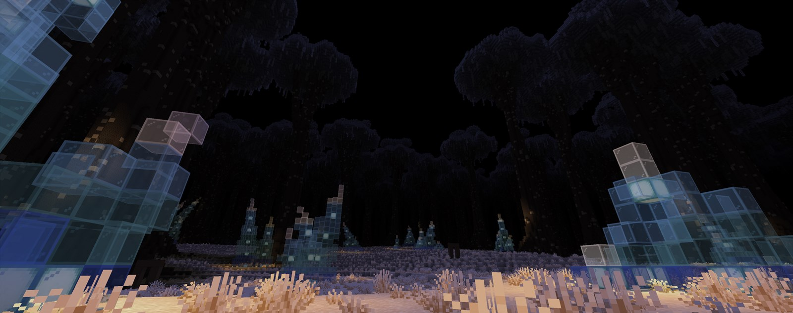
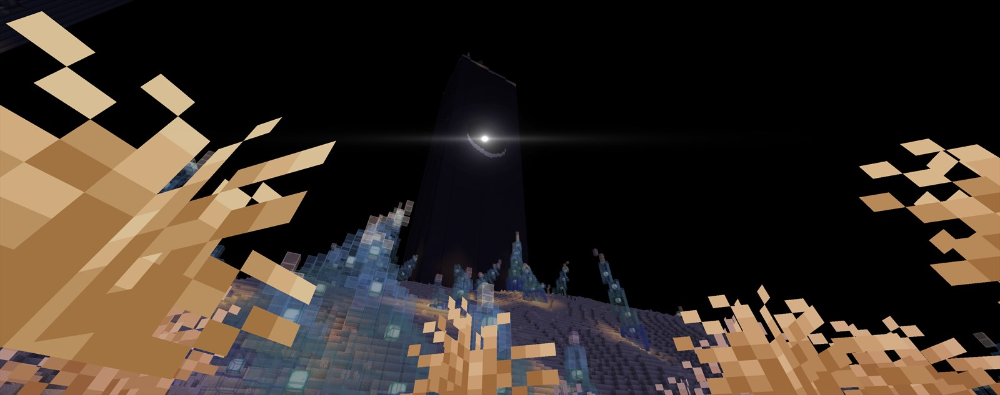
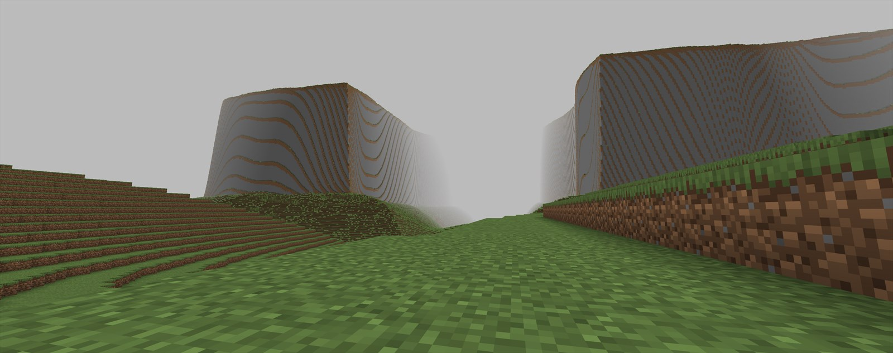
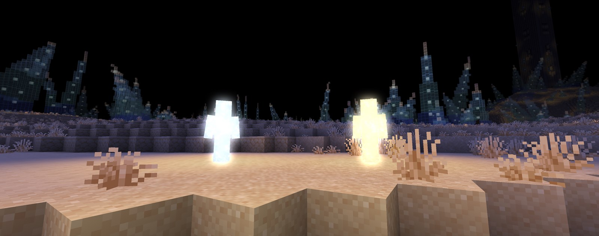
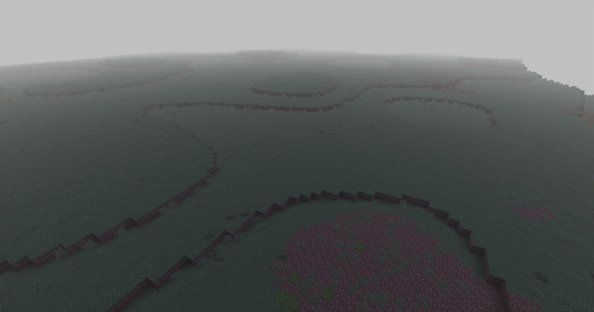
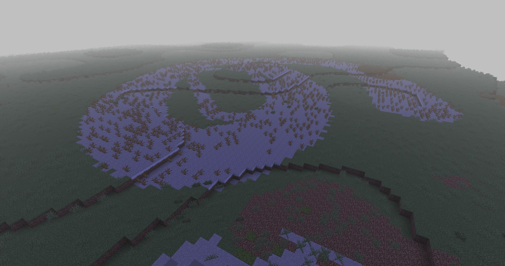

# AbyssalMadness

A Fabric mod for Minecraft 1.21.11 that replaces the overworld with a scripted horror
set, built as square rings around spawn. Each ring has its own terrain, sky, fog and
rules, and the whole thing is driven from one `/abyss` command so a scene can be set up
mid-recording.

<!-- HERO: the giant trees from below at night, canopy closing over the sky.
     Shoot around 9050 140 9050. F1 hides the HUD. 1920x1080. -->


## What it is

A tool for filming, not a gameplay mod. There is no progression and nothing to craft: it
generates a world that looks like somewhere, and gives a director the switches to make
things happen in it on cue. The rings are square because the metric is Chebyshev
distance, the levels hand over to each other rather than meeting at a line, and every
effect is built to survive being looked at from a kilometre away.

## The levels

Picked by distance from spawn, measured as `max(|x|, |z|)`.

| Level | Distance | What it is |
| --- | --- | --- |
| 0 | 0 - 1 500 | Flat hub, held at noon. The one place meant to read as safe |
| 1 | 1 500 - 5 000 | Gorges cut into plateaus. Phantom players you can hear but never find |
| 2 | 5 000 - 10 000 | Dunes and carved monoliths, giving way to a giant wood |
| 3 | 10 000 - 15 000 | Caves |
| 4 | 15 000 - 20 000 | A lattice of stone girders, endless in every direction |
| 5 | 20 000 - 25 000 | Floating islands, walled in at the edge |

## Features

### Worldgen

A custom density function and biome source replace overworld generation entirely.

<!-- SHOT: the odd monolith, the black tower bored through at mid-height.
     Stand back ~150 blocks so the hole reads against the sky. -->


<!-- SHOT: Level 1, wide, from the edge of a plateau looking down a gorge. -->


https://github.com/user-attachments/assets/f3309388-a868-4a0a-b7d2-850f2abb233e

The second half of Level 2 grows a canopy drawn **chunk by chunk rather than tree by
tree**, so the crowns actually meet and close over the sky. That matters: the Sleeping
Stars only reach a player who can see the sky, so the roof is the level's only cover.

### Infection

A post-process pass masked by the entity outline buffer, so the pattern is computed in
screen space and cut to the player's silhouette exactly. Two palettes, cold and warm.

<!-- SHOT: a cold hollow and a warm one side by side at night, where the glow reads.
     /abyss hollow spawn   and   /abyss hollow spawn warm -->


### Hollows

Player-shaped figures with their AI switched off, driven a tick at a time: they stand,
they watch, or they come at you in a straight line and do nothing else.

### The Cleansing

Something you never see sweeps down the level and passes through you. No entity and no
model - a moving point, the noise it makes, and the screen coming apart as it closes in.
You survive it by burying yourself. Sound on: it is heard long before it is seen.

https://github.com/user-attachments/assets/9c26021e-6b52-4e65-9985-410660f392a2

### Blackout

The world rendered as a sphere of dark around the player, plus a decay trail that rots
every column walked through. Both lie to the chunk mesh builder - no block is ever
changed, so nothing can be mined and nothing moves differently.

<!-- SHOT: a before/after pair for the decay trail. Same spot, same angle: one of
     untouched ground, one looking back at the dead strip.
     /abyss blackout decay on -->
| Before | After |
| --- | --- |
|  |  |

## How it works

The parts worth reading the source for:

- **Terrain is one density function.** `AbyssTerrain` implements `DensityFunction` and is
  referenced from the noise settings, with a `BiomeSource` picking biomes by the same
  square rings. Monoliths, pits, girders and islands are solved per block rather than
  placed, because a feature may only write to the eight chunks around its own - which
  caps how big anything built that way can ever be.
- **The canopy is drawn per chunk, not per tree.** One tree physically cannot reach the
  next, so crowns built tree by tree come out as separate lollipops with sky between
  them. Instead every chunk fills its own 16x16 columns and asks the terrain which trunks
  are near - their positions are a hash, not a roll, so a chunk can work out trees it
  never sees. The pieces join into a roof of unlimited extent.
- **The infection is cut by the entity outline buffer.** Marking a player as glowing
  fills that buffer with a solid silhouette, and the pass reads it as a pixel-exact mask.
  No geometric test can match it: arms swing out of any capsule.
- **Live uniforms in post chains.** Vanilla reads a post-effect JSON's uniforms once, when
  the pass is built. `PostUniforms` finds the buffer and overwrites it every frame.
- **Two chunk mesh hooks.** The blackout and the decay repaint the world by lying to the
  mesh builder. Sodium replaces that builder outright, so the vanilla hook applies
  cleanly and does nothing at all - there is a second hook into Sodium's `LevelSlice`, in
  its own mixin config so a setup without Sodium skips it rather than failing to boot.

## Commands

Ops only, all under `/abyss`.

| Command | What it does |
| --- | --- |
| `stars wake [seconds]` / `sleep` / `status` | The Sleeping Stars cycle |
| `infection <0-100> [players]` | Set an infection level |
| `warm on` / `off` `[players]` | Switch between the cold and the warm light |
| `immune on` / `off` `[players]` | Nothing can infect them. For whoever holds the camera |
| `hollow spawn [warm]` | Place a figure where you stand |
| `hollow watch on` / `off` | They turn to follow you |
| `hollow chase slow` / `fast` / `off` | They come at you |
| `hollow clear` | Remove them all |
| `ambient on` / `off` / `test` / `status` | Level 1 phantom-player sounds |
| `beacon anchor` / `activate` / `out` / `status` | Mark a spot, light it later |
| `cleansing start` / `stop` | A pass. Cover decides who lives |
| `cleansing <nick,nick>` | A pass where exactly these people live |
| `teleport [players]` | Level 4: the fog closes in and moves them |
| `blackout on` / `off` / `anchor` | The sphere of dark |
| `blackout radius <4-96>` / `noise <0-1>` | Its size, and how ragged the edge is |
| `blackout palette mono` / `void` / `rough` | Which gradient it fades through |
| `blackout follow <true/false>` | Follow the player, or stay put |
| `blackout decay on` / `off` / `clear` | The rotting trail |
| `blackout decay radius <0-8>` / `reach <1-64>` | How wide it is, how far up it rots |

## Building

```
./gradlew build
```

The jar lands in `build/libs`. Requires JDK 21.

Depends on Fabric API. [FogTools](https://modrinth.com/mod/fogtools) is optional: the
per-level fog goes through it by reflection and is skipped silently when it is absent.
Works with or without Sodium.

## License

CC0-1.0.
